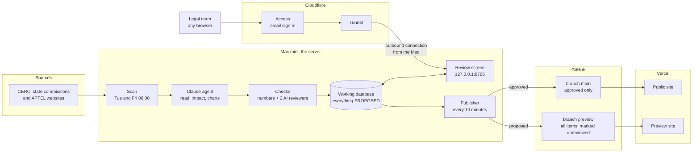

# Architecture

The Mac mini is the server. It scans, reads, holds the database and runs the review screen.
Vercel only shows what the Mac pushes to git. Nothing is published without a reviewer's approval.



## The parts

| Part | Where | What it does | Started by |
|---|---|---|---|
| Scan | Mac mini | Downloads new orders, drafts and regulations; Claude reads them; number check and two AI reviewers; everything lands as `proposed` | `ops/launchd/scan.plist`, Tuesday and Friday 06:00 |
| Review screen | Mac mini, `127.0.0.1:8765` | The legal team reads, edits, approves or rejects. Every action is recorded with the reviewer's name | `ops/launchd/review.plist`, always on |
| Tunnel | Mac mini to Cloudflare | An outbound connection, so the Mac needs no fixed address and no open port | `ops/launchd/tunnel.plist`, always on |
| Access | Cloudflare | Asks for the reviewer's email and a one-time code before any request reaches the Mac | Cloudflare Zero Trust |
| Publisher | Mac mini | `regstudio deploy`: writes approved items and pushes them to `main`; writes the unreviewed preview and pushes it to `preview` | `ops/launchd/deploy.plist`, every 10 minutes; also the button on the queue page; also the end of each scan |
| Public site | Vercel, branch `main` | Approved items only | Vercel build on push |
| Preview site | Vercel, branch `preview` | Everything, each item marked as awaiting review | Vercel build on push |

## The path of one order

1. **Tuesday or Friday, 06:00.** The scan fetches what each commission posted in the last 14 days.
2. Claude writes the summary, impact notes, charts and schematics. Each statement cites a paragraph.
3. The number check and the two AI reviewers test the summary. Their findings are stored for the reviewer.
4. The scan pushes the preview site. The order appears there marked "awaiting legal review".
5. A reviewer opens `https://review.<your-domain>`, signs in with their email through Cloudflare Access,
   reads the findings, edits and approves.
6. Within 10 minutes the publisher pushes the approved text to `main`. Vercel rebuilds the public site.

## How the studio learns

```
legal comment ──> revise (Claude) ──> reply + proposed revision ──> reviewer accepts / rejects
                                  └─> proposed lessons ──────────> reviewer approves on /memory
approved lessons ──> appended to every Claude prompt + data/memory/house_notes.md
read documents ──> learn (Claude) ──> up to four cited sector facts, proposed
```

The memory holds only what a reviewer approved: style notes (how the legal team wants things written) and
facts about the Indian power sector, each tied to a paragraph of a document. It grows with every scan and every
round of comments; nothing the model proposes is used until a person approves it.

Commercial illustrations (beta) are simple worked examples (energy, cost, sensitivity to tariff) built from cited
inputs and stated assumptions, computed by code, and approved by the jouleWise commercial team before the public
site shows them.

## What protects the review screen

- The screen listens on `127.0.0.1` only. The tunnel is the single way in from outside.
- Cloudflare Access lets through only the emails on its list.
- The screen itself checks the signed Access token on every tunnelled request (signature, application,
  issuer, expiry) and accepts only emails registered with `regstudio add-reviewer NAME --email …`.
  A tunnelled request with no valid token is refused, also when Access is switched off by mistake.
- The public site has no route to the Mac. It is static files built from git.

## What decides what is public

`regstudio deploy` writes the production data from rows with status `approved` and nothing else.
The model never sets that status; only the review screen does, for a named reviewer.
Sample documents are always dropped. The working folder is not touched: each push is made in its own
git worktree under `data/store/deploy/`.

## Docker and Postgres

Both are on the Mac mini; neither is used, on purpose.

- **Claude** runs through the Claude Code CLI signed in to the subscription in the Mac user's keychain.
  That sign-in is not available inside a container, so the scan runs on the Mac itself.
- **SQLite** is enough for this load: one scan writing twice a week and a few reviewers. It runs in
  write-ahead mode with a 30 second wait, and each scan first takes a backup copy (the last 14 are kept in
  `data/store/backups/`). A SQLite file shared between the Mac and a container is a known way to corrupt it.
- Move to Postgres when reviewers work in parallel all day, or when a second machine must write.
  The change is confined to `pipeline/regstudio/db.py` and the SQL in the stages.

## Not covered yet

- **APTEL and MERC are added by hand** (`regstudio fetch …`). APTEL has no downloader yet; MERC's site asks
  automated tools to stay out. The scan covers CERC, UPERC, RERC, GERC, KERC and TNERC.
- No message tells the legal team that a scan has finished. The queue page shows the time of the last scan.
